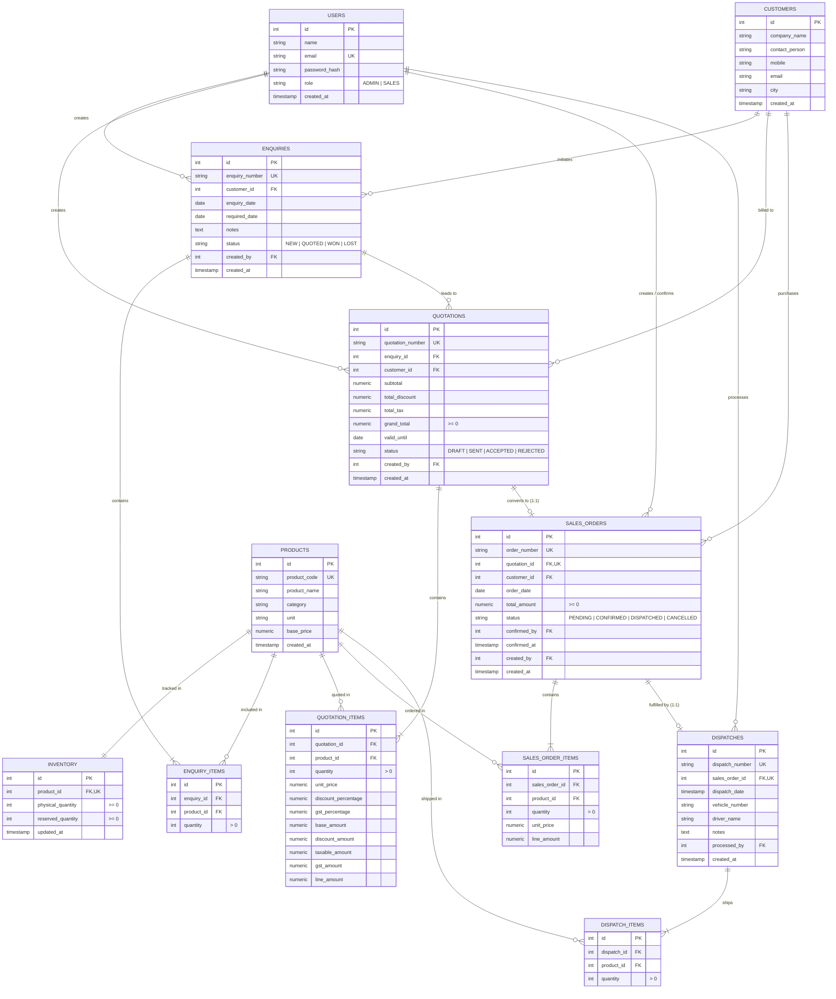

# Database Architecture & Relational ER Model

This document outlines the complete relational schema design for the **Fundsroom Industrial ERP** built on **PostgreSQL**.

---

## 1. Entity Relationship (ER) Diagram



---

## 2. Business Flow Traceability

Every transaction maintains complete lineage back to its inception:
$$\text{Customer} \longrightarrow \text{Enquiry} \longrightarrow \text{Quotation} \longrightarrow \text{Sales Order} \longrightarrow \text{Inventory Reservation} \longrightarrow \text{Dispatch}$$

1. **Customer**: Holds legal business entity details.
2. **Enquiry & Items**: Multi-product requirements with target delivery dates.
3. **Quotation & Items**: Calculates unit prices, commercial discount %, and GST %. Enforced and recalculated by the backend.
4. **Sales Order & Items**: Converted strictly from an `ACCEPTED` quotation.
5. **Inventory Ledger**: Maintains real-time `physical_quantity` and `reserved_quantity`. Formula:
   $$\text{Available Quantity} = \text{Physical Quantity} - \text{Reserved Quantity}$$
6. **Dispatch & Items**: Reduces both `physical_quantity` and `reserved_quantity` atomically.

---

## 3. Database Constraints & Data Integrity Safeguards

| Constraint Name | Target Table | Type | Purpose |
| :--- | :--- | :--- | :--- |
| `chk_available_stock` | `inventory` | `CHECK` | Enforces `physical_quantity >= reserved_quantity`, mathematically preventing negative available stock at the database engine level. |
| `chk_pos_qty` | `inventory` | `CHECK` | Enforces `physical_quantity >= 0 AND reserved_quantity >= 0`. |
| `unique_quotation_order` | `sales_orders` | `UNIQUE(quotation_id)` | Strictly prevents duplicate sales orders generated from a single quotation. |
| `unique_dispatch_order` | `dispatches` | `UNIQUE(sales_order_id)` | Strictly prevents duplicate dispatches of the same sales order. |
| `chk_line_amounts` | `quotation_items` | `CHECK` | Enforces non-negative monetary numbers. |
| `users_role_check` | `users` | `CHECK` | Limits roles strictly to `ADMIN` or `SALES`. |

---

## 4. Concurrency & Race Condition Resolution

### The Business Challenge
> Two concurrent requests arrive almost simultaneously:
> - Available Inventory = 100
> - User A attempts to reserve 80
> - User B attempts to reserve 50
> - Total demand = 130 > 100. Both reservations must not succeed!

### Technical Solution
We solve this using **PostgreSQL Transaction Isolation and Row-Level Locking (`SELECT ... FOR UPDATE`)**:

```sql
BEGIN;

-- 1. Acquire an exclusive row-level lock on the product's inventory row
SELECT physical_quantity, reserved_quantity,
       (physical_quantity - reserved_quantity) AS available_quantity
FROM inventory
WHERE product_id = $1
FOR UPDATE;

-- 2. Verify stock availability
-- If available_quantity < requested_quantity, trigger ROLLBACK and HTTP 400.

-- 3. Atomically increase reservation (Physical does NOT decrease)
UPDATE inventory
SET reserved_quantity = reserved_quantity + $requested_qty,
    updated_at = CURRENT_TIMESTAMP
WHERE product_id = $1;

-- 4. Mark Sales Order as CONFIRMED
UPDATE sales_orders
SET status = 'CONFIRMED', confirmed_by = $userId, confirmed_at = CURRENT_TIMESTAMP
WHERE id = $orderId;

COMMIT;
```

**Why this works:**
- The first transaction to execute `SELECT ... FOR UPDATE` acquires an exclusive lock on that row.
- The second concurrent request is put in a blocked queue by PostgreSQL until the first transaction completes.
- When the first transaction commits, `reserved_quantity` is already updated (e.g. from 0 to 80, leaving 20 available).
- The second transaction now reads the updated row, observes that only 20 units remain (which is less than the requested 50), and is rejected with an HTTP 400 error.
- Verified in automated test `tests/erp.test.js` under `Bonus Test: Concurrency and Race Condition Handling`.
